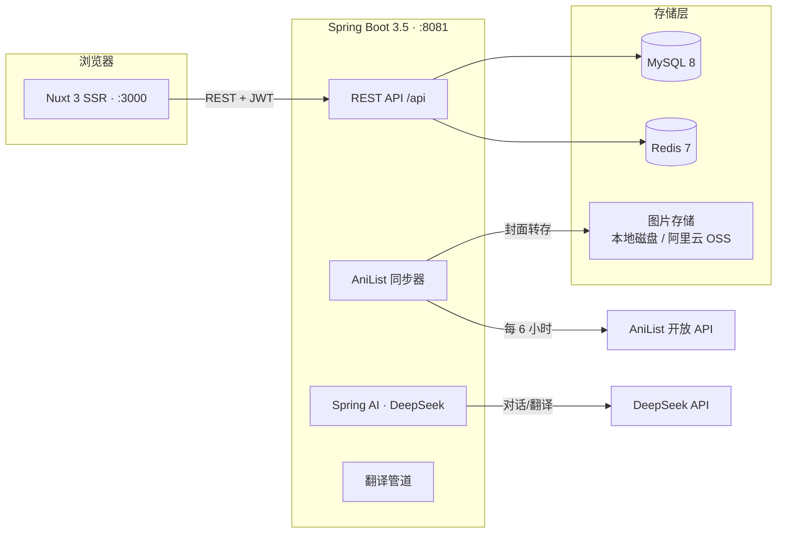

<div align="center">

# 🏮 AniGlow · 萤火番舍

**面向中文动漫爱好者的社区平台** —— 番剧图鉴 · 真实评分 · 社区讨论 · AI 角色对话

[](https://github.com/mjj90200-glitch/AniGlow/actions/workflows/ci.yml)


*5000+ 部番剧图鉴 · 99% 中文覆盖 · 157 项自动化测试守护*

</div>

---

## ✨ 它能做什么

| | 功能 | 说明 |
|---|---|---|
| 📚 | **番剧图鉴** | 接入 AniList 开放数据，5000+ 部番剧持续更新；支持 **题材 / 地区 / 年份 / 格式** 四维组合筛选（B 站式交互） |
| ⭐ | **真实评分** | 贝叶斯加权评分 + 社区评分 + 萤火投票，三套排行榜各有视角 |
| 💬 | **社区讨论** | 主题板块 · 楼中楼回复 · 图片上传（本地磁盘 / 阿里云 OSS 可切换） |
| 🤖 | **AI 角色对话** | 基于DeepSeek的角色扮演 Agent：**带短期对话记忆**、情感标签、每角色独立人设与模型配置 |
| 🈶 | **原生中文体验** | 标题 / 简介自动翻译管道（官方译名优先，社区译名级质量），99%+ 中文覆盖 |
| 🔁 | **全自动数据管道** | 每 6 小时从 AniList 同步番剧，封面自动转存自有存储，中文翻译自动补齐 |

## 🏗️ 技术架构



| 层 | 技术 |
|---|---|
| 前端 | Nuxt 3 · Vue 3 · Pinia · Tailwind CSS（SSR 开启） |
| 后端 | Java 21 · Spring Boot 3.5 · Spring Security(JWT) · JPA · **Spring AI 1.1** |
| 数据 | MySQL 8（Flyway 管理结构）· Redis 7（缓存 / 会话 / 排行榜） |
| AI | DeepSeek（Spring AI 统一接口，OpenAI 兼容端点可换） |
| 图片 | 本地磁盘 / 阿里云 OSS（`aniglow.storage.type` 一键切换） |
| 运维 | Docker Compose · Actuator · Prometheus 指标 · GitHub Actions CI |

请求统一使用 `ApiResponse<T>` 信封；前端业务请求通过 `useApi()` 注入 JWT、解析错误和透传 `X-Trace-Id`。后端按 Controller → Service → Repository 分层，事务只放在 Service。

---

## 📋 环境要求

| 依赖 | 版本 | 必需 | 用途 |
|---|---|---|---|
| JDK | **21** | ✅ | 后端编译与运行 |
| Node.js | 18+ | ✅ | 前端构建 |
| pnpm | 10.x | ✅ | 前端依赖管理 |
| MySQL | 8.x | ✅ | 业务数据 |
| Redis | 7.x | ✅ | 缓存 / 会话 / 排行榜 |
| DeepSeek API Key | — | ⭕ | AI 对话与翻译（无 Key 时其余功能不受影响） |

---

## 🚀 快速启动

> 💡 全程约 10 分钟。走完你将得到：前端 `http://localhost:3000` + 后端 `http://localhost:8081/api` + 5000 部自动同步的番剧数据。

### ① 克隆项目并安装前端依赖

```bash
git clone https://github.com/mjj90200-glitch/AniGlow.git
cd AniGlow
pnpm install
```

> 没有 pnpm？`npm i -g pnpm@10` 或 `corepack enable`

### ② 准备数据库

```sql
CREATE DATABASE aniglow CHARACTER SET utf8mb4 COLLATE utf8mb4_unicode_ci;
```

表结构**无需手动创建**：后端启动时自动管理（见下方「数据库结构」）。

### ③ 配置环境变量

```bash
cp .env.example .env
```

编辑 `.env`，最少只需确认这两项：

```bash
# 后端数据库连接（默认 localhost:3306/aniglow）
MYSQL_USER=root
MYSQL_PASSWORD=你的数据库密码

# AI 能力（在 platform.deepseek.com 免费注册获取）
AI_API_KEY=sk-xxxxxxxx
```

<details>
<summary>🔑 生成两个随机密钥（安全必需，点击展开）</summary>

```bash
# JWT 登录令牌签名密钥 & 前后端认证桥接密钥（各 32 字符以上）
JWT_SECRET=$(openssl rand -base64 32)
AUTH_BRIDGE_SECRET=$(openssl rand -base64 32)
echo "JWT_SECRET=$JWT_SECRET"
echo "AUTH_BRIDGE_SECRET=$AUTH_BRIDGE_SECRET"
```

把输出的两行追加到 `.env`，并同步写入 `.env.local`（本地密钥文件，已被 gitignore）。

</details>

### ④ 启动后端（:8081）

```bash
cd aniglow-backend
mvn spring-boot:run -Dspring-boot.run.profiles=dev
```

看到 `Started AniglowApplication` 即成功。**启动约 3 分钟后**会自动开始首轮番剧数据同步（AniList，5000 部，需保持网络畅通）。

<details>
<summary>⛓️ 备选：以打包 JAR 方式运行（含启动脚本）</summary>

```bash
mvn -B clean package            # 产出 target/aniglow-backend-1.0.0.jar
cd ..
./start-backend.sh              # 自动加载 .env/.env.local，运行 JAR
```

</details>

### ⑤ 启动前端

新开一个终端：

```bash
pnpm dev
```

### ⑥ 验证

打开 **http://localhost:3000** —— 注册一个账号，去番剧页筛选一部今天的心动之作吧 🎉

再验证一下后端：

```bash
curl http://localhost:8081/api/actuator/health
# {"status":"UP",...}
```

---

## ⚙️ 环境变量一览

<details>
<summary><b>后端（aniglow-backend）</b></summary>

| 变量 | 必填 | 默认 | 说明 |
|---|---|---|---|
| `MYSQL_USER` / `MYSQL_PASSWORD` | ✅ | — | 数据库账号 |
| `SPRING_DATASOURCE_URL` | ⭕ | `localhost:3306/aniglow` | 数据库地址 |
| `JWT_SECRET` | ✅ | — | JWT 签名密钥（≥32 字符） |
| `AUTH_BRIDGE_SECRET` | ✅ | — | 前后端认证桥接密钥（≥32 字符，与前端一致） |
| `AI_API_KEY` | ⭕ | — | DeepSeek API Key（AI 对话 / 翻译） |
| `AI_BASE_URL` | ⭕ | `https://api.deepseek.com` | OpenAI 兼容端点，可换其他供应商 |
| `AI_MODEL` | ⭕ | `deepseek-flash` | 对话模型 |
| `ANIGLOW_TRANSLATION_MODEL` | ⭕ | `deepseek-chat` | 批量翻译模型（非推理，速度快） |
| `STORAGE_TYPE` | ⭕ | `local` | 图片存储：`local` / `oss` |
| `OSS_ENDPOINT` `OSS_BUCKET` `OSS_ACCESS_KEY_ID` `OSS_ACCESS_KEY_SECRET` | ⭕ | — | OSS 四件套（`STORAGE_TYPE=oss` 时必填） |
| `OSS_CUSTOM_DOMAIN` | ⭕ | — | 自定义加速域名（需备案） |

</details>

<details>
<summary><b>前端（Nuxt）</b></summary>

| 变量 | 默认 | 说明 |
|---|---|---|
| `NUXT_BACKEND_URL` | `http://localhost:8081` | 后端地址 |
| `NUXT_PUBLIC_SITE_URL` | `http://localhost:3001` | 站点对外地址（SEO 用） |
| `NUXT_AUTH_BRIDGE_SECRET` | — | 与后端 `AUTH_BRIDGE_SECRET` 保持一致 |

</details>

---

## 🤖 AI 能力说明

角色对话与翻译基于 **Spring AI 1.1 统一模型接口**，默认接入 DeepSeek：

| 场景 | 模型 | 说明 |
|---|---|---|
| 角色对话（流式） | `deepseek-flash` | 推理模型，带情感标签输出与短期对话记忆 |
| 标题 / 简介翻译 | `deepseek-chat` | 非推理模式，批量处理快（`aniglow.translation.model` 可配） |

- 所有 AI 调用带 **90 秒读超时 + 3 次重试**，供应商故障时优雅降级，不影响站点其他功能
- 更换供应商（火山方舟 / GLM / OpenAI 等）：只需修改 `AI_BASE_URL` + `AI_API_KEY` + `AI_MODEL` 三个变量

---

## 🗄️ 数据管道

| 管道 | 频率 | 说明 |
|---|---|---|
| AniList 番剧同步 | 每 6 小时 | 热度榜 Top 5000，封面自动转存自有存储 |
| 中文标题补齐 | 手动触发 | 官方译名优先的批量翻译（15 部/次） |
| 中文简介补齐 | 手动触发 / 启动时自动 | 逐条翻译，进度实时可见 |

> 触发方式：`POST /api/admin/repair/titles` 与 `POST /api/admin/repair/synopses`（需 ADMIN 角色）

---

## 🖼️ 图片存储

图片存储通过 `ImageStore` 接口抽象，`STORAGE_TYPE` 一键切换：

- `local`（默认）：写入 `~/aniglow-data/images`，由后端直接对外提供
- `oss`：写入阿里云 OSS，支持自定义加速域名；存量图片可用管理端点一键迁移

> 切换到 OSS 后，数据库中的旧图片链接会由内置兼容层自动 302 到新地址，无需修改任何数据。

---

## 🔧 管理端点速查

需 `ADMIN` 角色（注册后手动提权：`UPDATE users SET role='ADMIN' WHERE username='你的用户名';`）。

| 端点 | 说明 |
|---|---|
| `POST /api/admin/sync/full` | 全量同步番剧（Top 榜 + 当季 + 即将上映） |
| `POST /api/admin/anime/covers/migrate` | 存量番剧封面迁移到自有存储 |
| `POST /api/admin/repair/titles` | 批量补齐中文标题（15 部/次，官方译名优先） |
| `POST /api/admin/repair/synopses` | 批量补齐中文简介 |
| `POST /api/admin/storage/migrate` | 本地存量图片迁移到 OSS |
| `POST /api/admin/rankings/rebuild` | 重建 Redis 排行榜 |
| `GET /api/admin/system/status` | 系统运行状态 |

---

## 🧪 质量门禁

```bash
pnpm test                     # 前端测试（Vitest）
pnpm exec nuxi typecheck      # 前端类型检查
cd aniglow-backend && mvn verify   # 后端全量测试（130 项）
```

---

## 📂 项目结构

```
├── pages/                  # Nuxt 页面（番剧/社区/每日任务/AI 对话/个人中心）
├── components/             # Vue 组件
├── composables/            # 组合式函数（useApi/useAnime/useAuth...）
├── server/api/             # Nuxt 服务端路由（BFF 代理）
├── aniglow-backend/
│   └── src/main/java/com/aniglow/
│       ├── controller/     # REST 控制器
│       ├── service/        # 业务服务（Agent/翻译/同步/配额...）
│       ├── storage/        # 图片存储抽象（本地 / OSS）
│       ├── config/         # 配置（Security/AI/存储/初始化）
│       └── entity/         # JPA 实体
│   └── src/main/resources/db/migration/   # Flyway 迁移脚本
├── docker-compose.yml      # 一键部署（MySQL/Redis/后端/前端）
└── .env.example            # 环境变量模板
```

---

## 📌 补充说明

- **数据库结构**由 `aniglow-backend/src/main/resources/db/migration` 中的 Flyway 脚本管理，新增字段或索引时创建下一个 `V<版本>__<说明>.sql`，不要修改已发布的迁移
- **Redis 缓存**默认使用 `aniglow::` 键前缀；多实例共享 Redis 时通过 `ANIGLOW_CACHE_KEY_PREFIX` 设置独立命名空间
- `.env` 与 `.env.local` 包含密钥，**已被 gitignore，不要提交**
- 首次启动的番剧数据来自 AniList 开放接口；确定不再使用 Jikan 数据源时，可移除 `aniglow-backend` 中遗留的 Jikan 相关代码

## 🙌 致谢

- [AniList](https://anilist.co) — 开放番剧数据源
- [DeepSeek](https://platform.deepseek.com) — AI 能力
- [Spring AI](https://spring.io/projects/spring-ai) · [Nuxt](https://nuxt.com) — 上层框架

<p align="center"><i>萤火虽微，愿为其芒 🌟</i></p>
